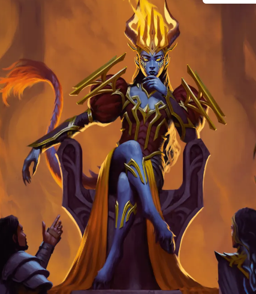
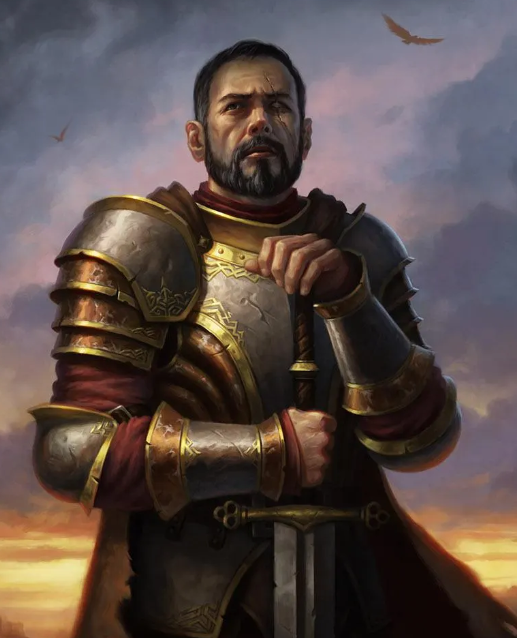
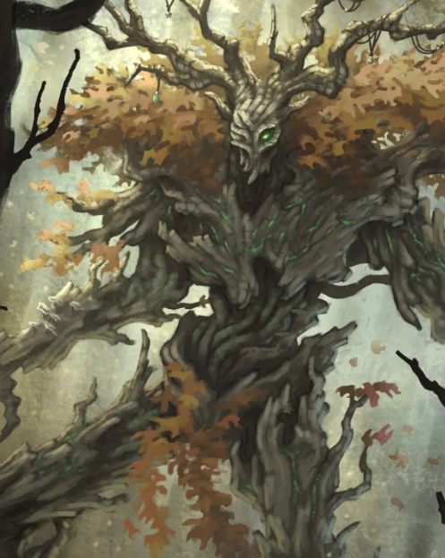
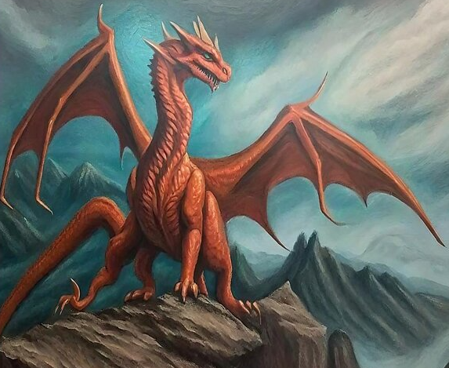

[[Vasloria - A living encylopedia]]

## Timeline

Dates are approximate years before the campaign’s present, not calendar dates.

| Years ago | Event |
| --- | --- |
| 6,000 | Elder gods create life; other gods begin arriving. |
| 4,000 | Divine interference ends with the gods’ banishment. Three demigods remain as stewards. Civilization declines as mortals gain independence; worship shifts toward the world and the numinous. |
| 3,000 | Nature dominates; small pockets of civilization remain. |
| 2,000 | Shelter’s first layer is founded under Justice. The original timeline describes an order without heart, dominated by capitalism. People move into the city and life outside contracts. |
| 1,000 | The Maiden upstages Justice. |
| 950 | The Maiden and the Wyrm separate. He begins burning nature; stone dwarves come to Shelter and cohabit with flesh dwarves. Thruthir begins mining beneath the city. |
| 900 | A new upper layer is built. Thruthir’s prejudice helps send stone dwarves upward. Flesh dwarves remain below, preferring life out of sunlight; stone dwarves buy quartz from Thruthir. Resentment persists. |

## History in the current story

- The divide surfaces in [[Session 1 — Brenda’s Tavern]] and is deliberately reinforced in [[Session 2 — Catch the Arson!]].
- Shelter’s layers become tangible in [[Session 3 — Ghouls and Demons]].
- Divine stewardship and creation become immediate stakes in [[Session 4 — Demigods in the Mines]].
- The historian’s account is learned in [[Session 5 — The House of Clan Lodgy]]; the wedding may challenge this inherited conflict in [[Session 6 — The Finale]].

People behind these events: [[NPCs — People, Powers & Factions]]. Present-day geography: [[Locations — Shelter & Beyond]]. Heroes shaping what comes next: [[The Party — Players & Characters]].

## Founding traditions

Session 5’s high elf historian describes stone and flesh dwarves originally living in the mountains. King Dramhail remained in his halls while flesh dwarves followed Justice and selected Shelter’s site. Caramin’s writings suggest some stone dwarves, perhaps outside Dramhail’s faction, participated.

Flesh dwarves hollowed the city’s foundation with their hands and songs. Later, stone dwarves fleeing a great flying beast helped rebuild failing lower levels and received upper levels of the city.

## The dwarven divide

Thruthir’s rumors and exploitation turned shared habitation into segregation. The character notes describe expulsions except for a poor stone-dwarf enclave paid little money and saltpeter. The political divide persists in commerce, family loyalties, and hostility to Zaar and Lurza’s relationship.

The Session 2 arson instructions explicitly seek to turn Gruin against flesh dwarves and prevent the heroes from healing this engineered divide.

## Divine background

The Four Elder Gods withdrew because their presence compromised mortal free will. Fealti, One, and Awe remained to love kindly, promote justice, and steward nature. Their icons authenticate their place in the world.

  <figure style="margin:0;text-align:center;">
    
    <figcaption><em>Fealti — the Maiden</em></figcaption>
  </figure>
  <figure style="margin:0;text-align:center;">
    
    <figcaption><em>One — Justice</em></figcaption>
  </figure>
  <figure style="margin:0;text-align:center;">
    
    <figcaption><em>Awe — steward of nature</em></figcaption>
  </figure>

Gods act through intermediaries and limited manifestations. Churches honor saints or heroes rather than gods; the Church of Eseld the Ultimate is associated with Cyrvis the Lich in the religion notes.

### The Maiden and the Wyrm

The Maiden’s estranged husband was once a dragon knight; jealousy and the marriage to power transformed him into the Weeping Wyrm. Their separation around 950 years ago marks the beginning of his burning of the wilderness beyond Shelter.

<figure style="margin:1.5rem auto;text-align:center;">
  
  <figcaption><em>The Maiden and her husband, the Weeping Wyrm.</em></figcaption>
</figure>

## History of the Champion Games

On the 23rd of Rainmoot, the Thieves Guild killed the Dockworkers Union in State-sponsored games. Later arena practices changed as volunteers stopped coming and champions kept dying. The one-shot notes describe a move away from universal death matches toward event-specific rules.

## Unresolved chronology and terminology

- The founding story says the stone dwarves arrived “1,000 years later,” while the original timeline places their arrival around 950 years ago. Keep both approximate accounts pending a definitive chronology.
- The character notes place the dwarves’ peaceful coexistence and Thruthir’s rumors around 1,000 years ago; the timeline emphasizes the layer change around 900 years ago.
- History calls the Wyrm’s separation a divorce; demigod lore portrays estrangement and a continuing power bond. The relationship’s formal status needs confirmation.
- A proposed myth about Bik cursing a boulder appears under “Didn’t happen” in Campaign Notes. It is not treated here as established history.

## Original records

[[History]] · [[Religion]] · [[Demigods]] · [[Campaign Notes]]