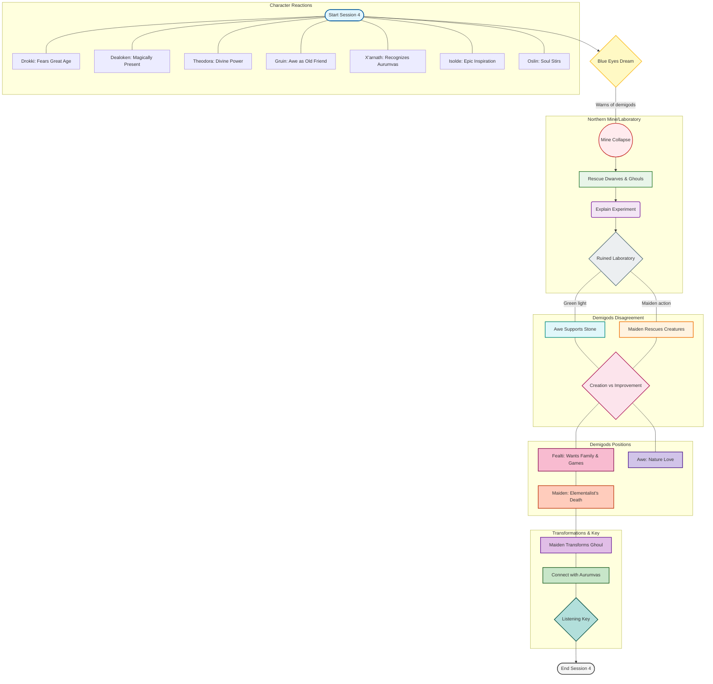

[[Plot — Six Sessions]] · [[Session 4 — Demigods in the Mines]] · [[Vasloria - A living encylopedia]]

## Session 4 Flowchart: Demigods in the Mines

## Node Details (Hover Text)

| Node | Brief Title | Full Description |
|------|-------------|------------------|
| Start | Session 4 Begins | A dream featuring blue eyes warns of the demigods' activities before a nighttime collapse in the northern mine. |
| Dream | Blue Eyes Dream | The party experiences a prophetic dream with blue eyes, warning them about Fealti and Awe's experiments beneath Shelter. |
| MineCollapse | Northern Mine Collapse | A nighttime collapse brings dust, cries for help, trapped dwarves, and ghouls that need urgent rescue. |
| Rescue | Rescue Operation | The party works to free the injured dwarves and displaced ghouls from the collapsed mine tunnels. |
| InjuredDwarf | Experiment Explanation | An injured dwarf reveals an experiment went wrong; prejudice may complicate accepting healing from a stone dwarf. |
| RuinedLab | Laboratory Discovery | A green light and ruined laboratory reveal where Awe supports stone while the Maiden rescues creatures. |
| AweSupportsStone | Awe's Position | Awe wants to improve the beings' lives and provide a love of nature rather than obsession with Fealti. |
| MaidenRescues | Maiden's Action | The Maiden focuses on rescuing creatures in the laboratory, disagreeing with Awe about creation vs improvement. |
| Disagreement | Demigods Debate | The core conflict: should they create anew or improve existing attempts? They speak of needing their brother. |
| Fealti | Fealti's Proposal | Claims she wants a family and provides housing, feasts, and public games for the party. |
| Awe | Awe's Vision | Advocates for nature-based love and better lives for all beings rather than divine obsession. |
| MaidenWarning | Maiden's Prophecy | Refers to the Elementalist's death and predicts heroes will never heal the dwarves' divide. |
| GhoulTransform | Animated Ghoul | The Maiden transforms a ghoul into an animated ghoul in front of the party as demonstration. |
| ConnectAurumvas | Contact Aurumvas | The Maiden asks heroes to connect her with Aurumvas; completion of follow-ups not separately recorded. |
| ListeningKey | Living Key | The party receives a key that listens to them and can be flipped to speak with the Maiden's voice. |

## Notable Events

- **Prepared rescue** - Collapse brings dust, cries for help, dwarves, and ghouls needing rescue
- **Disagreement** - Demigods debate whether to create anew or improve existing attempts
- **Transformations** - Ghoul transformed into animated ghoul; key with speaking ability given to party
- **Character reactions** - Each party member had distinct reactions to the demigods' presence and powers

[[Session 3 — Ghouls and Demons]] · [[Session 5 — The House of Clan Lodgy]]
