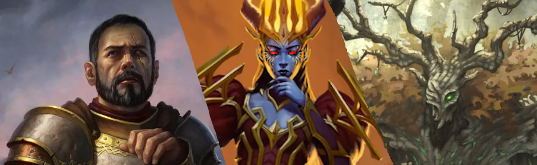

<figure style="margin:0 0 1.5rem;text-align:center;">
  
  <figcaption><em>The three demigods: Justice, Fealti, and Awe.</em></figcaption>
</figure>

A living reference for the Vasloria campaign: the city of Shelter, its people, its history, and the heroes changing its future.

> [!note] 🔒 Director's edition
> This site includes secrets and session planning. Planned scenes are not automatically established events.

## Encyclopedia

- [[Plot — Six Sessions]]
- [[The Party — Players & Characters]]
- [[NPCs — People, Powers & Factions]]
- [[Locations — Shelter & Beyond]]
- [[History — Gods, Shelter & the Dwarven Divide]]
- [[Random NPC Names — Naming & Casting]]

## Six-session route

1. [[Session 1 — Brenda’s Tavern]]: the party meets Zaar and confronts prejudice.
2. [[Session 2 — Catch the Arson!]]: a staged attack exposes deliberate division.
3. [[Session 3 — Ghouls and Demons]]: the trail descends through Shelter’s older layers.
4. [[Session 4 — Demigods in the Mines]]: the heroes encounter Fealti and Awe’s experiments.
5. [[Session 5 — The House of Clan Lodgy]]: diplomacy, history, and plans for a future together.
6. [[Session 6 — The Finale]]: wedding and confrontation possibilities; outcome unrecorded.

## About this edition

[[Vasloria - A living encylopedia|Read the full director's introduction]] for notes on maintaining the living record.
